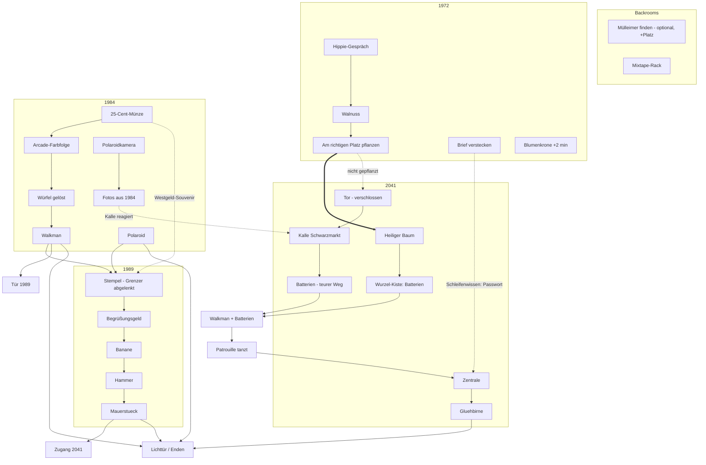
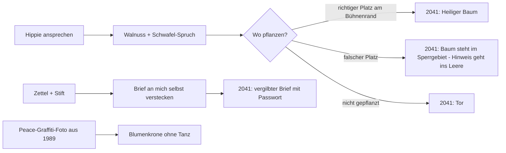
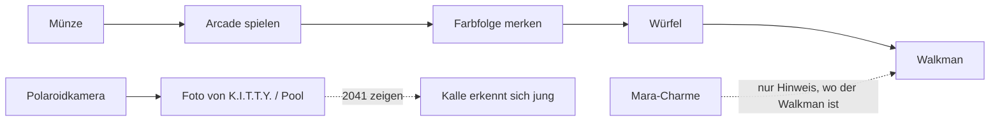
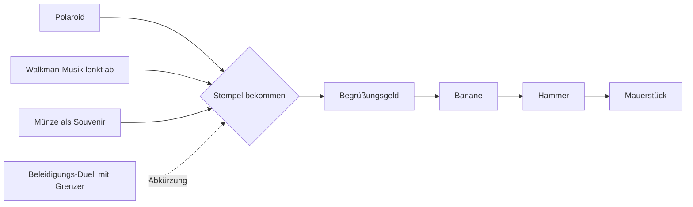
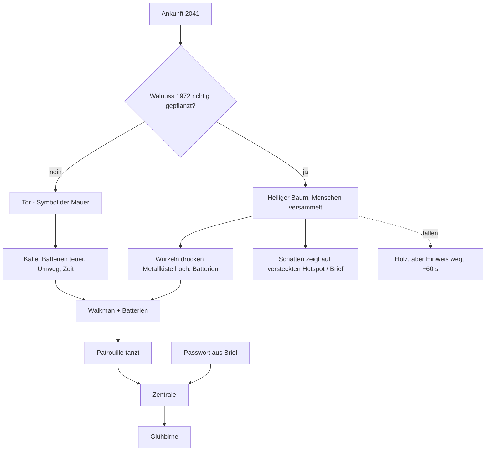

# Story- & Rätselkonzept – Rewind: Die Zeitschleife

> **Update 14.10. (Petes Quest-Test):** Starke Glitch-Effekte sind in VR unerträglich. Alle Glitch-Stufen nur noch als dezenter Fake-VHS-Glitch (leichtes Rauschen, Tracking-Streifen am Rand, kurzer Ton-Leiher). Kein RGB-Split, keine springenden Hotspots, kein Flackern im Blickfeld. Steigerung über Ton, Erzähler-Sprüche und Zeitkosten statt über visuelle Stärke.

> **Festlegung (Pete):** Kein Hotspot-Glühen, keine Hotspot-Anzeige. Testphase vorbei, das Spiel soll fordernd sein. Hinweise kommen ausschließlich über Mara und den Erzähler im 3-Stufen-System. Trefferflächen bleiben groß, aber unsichtbar (VR-Laser und Handy).

*Stand: 13.10.2026 · für Pete und Captain Chaos · baut auf `raetsel_handbuch.md` und `zeitschleife_ideen.md` auf · Code nicht angefasst, alles Vorschlag*

**Leitidee:** *Wissen bleibt, Gegenstände nicht.* Die Schleife ist kein Strafmechanismus, sondern das Werkzeug: Wer zurückkehrt, weiß mehr, zahlt aber mit Zeit und Stabilität (Glitches). Alles jugendfrei, alle Hommagen nur als Anspielungen (keine Originalnamen, Logos, Grafiken, Filmausschnitte, Musik).

---

## 1. Gesamtüberblick

| Ära | Rolle in der Story | Haupt-Neuerung |
|---|---|---|
| **Backrooms** (Hub) | Start, Zwischenraum, Ärenwahl über den Zeitwalkman | Mülleimer, Kennzeichen-Easter-Egg, Mixtape-Rack |
| **1972 Festival** | Ursachen-Ära: hier wird gesät | Walnuss-Hippie, Brief an sich selbst, Hängematten-Falle |
| **1984 Pool / K.I.T.T.Y.** | Werkzeug-Ära: Münze, Würfel, Walkman | Rathausuhr-Easter-Egg, Polaroid-Fotos, Wahlkampf-Falle |
| **1989 Mauerfall** | Wende-Ära: Mauer als Motiv | Stempel-Zwischenschritt, Beleidigungs-Duell, Rückwärts-Szene |
| **2041 Dystopie** | Wirkungs-Ära: hier zeigt sich alles | Baum-oder-Tor, zwei parallele Ziele, Kalle alt |

**Ziel (unverändert):** 3 Anker (Walkman, Mauerstück, Glühbirne) + Polaroid → Lichttür. Neu ist ein **zweiter Weg nach 2041** (Baum statt Tor) und mehr Gründe, in frühere Ären zurückzukehren.

## 2. Gesamt-Dependency-Chart

*Durchgezogen = Pflicht, gestrichelt = alternativer/bonus Weg, dick = Kernidee Baum.* Die beiden 2041-Ziele (Batterien und Zentrale-Zugang) laufen parallel, so hat man immer etwas zu tun.

## 3. Pro Ära

### 3.1 Backrooms (Hub)
- **Mülleimer** (Petes Idee): unauffällig, aber groß im Halbdunkel. *Wegwerfen* und *Durchwühlen* (Items zurückholen). Erzähler-Running-Gag zum Inhalt. Wer ihn nicht findet: abgelegte Pflicht-Items fallen an ihren Fundort zurück, also keine Sackgasse.
- **Mixtape-Rack:** Hier wählt man die Kassette für den Walkman (je Ära ein Song). Rätsel: Ein Hinweis ist nur **rückwärts gespult** hörbar (Taste halten = zurückspulen).
- **Easter Egg:** Kennzeichen eines berühmten Zeitreise-Sportwagens an der Wand (ohne Original-Schriftzug, z. B. „OUTATIME“-artige Fantasie-Variante).
- **Glitch-Zähler** zeigt sich hier als Riss in der Wand, der mit jeder Schleife wächst (reines Bild-Overlay).

### 3.2 1972 Festival – „Was du heute säst“

- **Hippie-Spruch:** „Was du heute in die Erde legst, zeigt dir morgen den Weg, Mann … die Wurzeln wissen, wo das Metall schläft.“ Erzähler trocken, später der Aha-Moment.
- **Brief an sich selbst:** Das Passwort erfährt man erst in einer Schleife (z. B. nach Game Over in der Zentrale). In der nächsten Schleife schreibt man es 1972 auf und versteckt es; 2041 liegt es vergilbt im Baum bzw. hinter dem Tor.
- **Falsche Antwort mit Zeitabzug:** „Kurz in die Hängematte legen“ → Einschlaf-Clip, −20 s.
- **Easter Egg:** blaue Notruf-Telefonzelle, nur im Glitch-Flackern sichtbar (ab Besuch 2).
- **Hommage:** spitzer Zaubererhut an der Garderobe des Bühnenzelts („Falsches Abenteuer, Kumpel.“).
- **Köder:** Lavalampe.

### 3.3 1984 Pool & K.I.T.T.Y.

- Walkman nicht mehr billig: Charme gibt nur noch einen Hinweis (Handbuch Kap. 8.2).
- **Polaroid-Mechanik:** Kamera hat 3 Bilder. Fotos sind Inventar-Items, die man Leuten in anderen Ären zeigt (Kalle 2041, Grenzer 1989 „Ist das Westen?“).
- **Kalle jung:** Bademeister-Lehrling, der Sachen unter der Hand tauscht.
- **Falle:** K.I.T.T.Y. nach ihrem „Wahlkampfprogramm“ fragen → hört nicht auf, −25 s.
- **Easter Egg:** stehengebliebene Uhr mit Blitzspur, Erzähler: „10:04 Uhr. Interessant.“
- **Hommage:** Hamster + Mikrowelle in der Imbissküche, nicht kombinierbar („Nein. Einfach nein.“).
- **Köder:** Würfel-Schlüsselanhänger, Stirnband, Kassette „Hits 84“.

### 3.4 1989 Mauerfall

- Bananen-Kette um den Stempel-Schritt verlängert, mit **drei Wegen** zum Stempel (Ablenkung, Souvenir, Wortduell).
- **Hommage:** Wort-Duell mit (harmlosen) Sprüchen gegen den Grenzer, Antworten muss man vorher bei anderen NPCs aufschnappen. Gummihuhn mit Seilrolle als Köder, kombinierbar mit nichts.
- **Falle:** „Gibt es dafür ein Formular?“ → Vortrag über Formulare, −20 s, Erzähler seufzt.
- **Easter Egg:** Karton „Zeitreise-Kram – nicht öffnen“ im Grenzerhäuschen.
- **Rückwärts-Szene** (Kann): ab Besuch 3 läuft 1989 einmal rückwärts (Clip rückwärts abgespielt, Ton umgedreht). Lösung von hinten: Man muss die Mauer „zusammenkleben“, um ein verlorenes Item zu bekommen. Sehr billig, da vorhandene Clips nur umgekehrt werden.
- **Köder:** leere Akte, Trabi-Radkappe.

### 3.5 2041 Dystopie – Baum oder Tor

- **Ohne Baum:** Man steht vor einem Tor. Weiterkommen nur über Kalles Schwarzmarkt (teurer, langsamer). Der Spieler soll spüren: Da fehlt was.
- **Mit Baum:** Das Tor wurde nie gebaut. Erzähler/Mara: „Komisch, wie ein Baum mehr verbindet, als jede Mauer trennt.“ Bezug zu 1989 wird damit explizit.
- **Aha-Moment:** Erzähler zitiert den Hippie, Mara: „Okay, der Typ war doch nicht nur verpeilt.“
- **Kalle alt:** erkennt einen („Dich kenn ich doch vom Pool!“), reagiert auf das Polaroid-Foto mit Rabatt.
- **Falle:** Kalle nach „seiner Geschichte“ fragen → endlose Erzählung, −30 s.
- **Easter Egg:** Metallhand in den Trümmern, Mara: „Die kommt bestimmt wieder.“
- **Hommage:** Poster mit lila Tentakel in der Disco; Peitsche an der Wand („Falsches Spiel, Kumpel.“).
- **Köder:** Pappbrille, Gutschein „1 Glück“.

## 4. Schleifen- & Erzähler-Systeme (ärenübergreifend)

| System | Regel |
|---|---|
| **Glitches je Rückkehr** | Besuch 1 normal → 2 Flackern/VHS → 3 RGB-Split, Sätze aus anderen Ären → 4 Hotspots springen → 5+ fast unspielbar, **nie gesperrt**, kostet Zeit. Glitches zeigen auch Geheimnisse (Easter Eggs, Hinweise). Optionsschalter „Glitch-Intensität“, keine Kamerabewegung, keine harten Blitze. |
| **Mara erinnert sich** | Ab Schleife 3: „Moment, das hatten wir schon“ + Bonushinweis (kostenlos, Stufe 2). |
| **Lügender Erzähler** | Ab Schleife 3 lügt er gelegentlich bei Stufe-1-Hinweisen (immer harmlos, nie bei Pflicht-Hinweis ohne Gegenstimme). Mara korrigiert: „Hör nicht auf ihn.“ Spieler lernt, Quellen zu vergleichen. |
| **Hinweise 3 Stufen** | Erzähler vage → Mara Ort → Mara zeigt (siehe Handbuch Kap. 4). Feste `hint`-Texte entschärfen. |
| **Inventar** | 6 Plätze, Anker zählen nicht. Mülleimer +Platz (bzw. Ablage). |
| **Speedrun** | Nach dem ersten Ende freischaltbar: Bestzeit pro Ende lokal speichern, Rest-Countdown als Score. |

## 5. Countdown-Logik

Basis bleibt: **20:00 min**, +2:00 durch Blumenkrone (vorhanden).

| Ereignis | Effekt | Grenze |
|---|---|---|
| Easter Egg gefunden (Zeitreise-Anspielung) | **+30 s** + Rückspul-Sound | jedes Egg nur 1× pro Spielstand |
| Klassiker-Hommage gefunden | **+20 s** | 1× pro Spielstand |
| Lustige falsche Antwort (1 pro Dialog) | **−15 bis −30 s** + eigener Clip/Spruch | Jede Falle zieht nur beim 1. Mal pro Schleife ab, danach nur Spruch |
| Rückkehr ab Glitch-Stufe 5 | **−30 s** pro Eintritt | – |
| Baum fällen | **−60 s** | – |
| Hinweis Stufe 3 | 0 s, nur Spott-Spruch | – |
| Game Over | Schleife beginnt neu, Wissen/Tagebuch/Easter-Egg-Bonus bleiben | – |

**Deckel:** Bonuszeit gesamt max. +5 min, damit der Druck bleibt. Countdown nie unter 1 min durch Abzüge allein (letzte Minute nur durch echte Zeit). Anzeige: Kurzes „+0:30“/„−0:20“ am Walkman-Display, kein extra Zähler (Petes Wunsch: nicht zu kompliziert).

## 6. Kostenschätzung (qualitativ)

| Idee | Neue Assets | Wiederverwendbar | Aufwand |
|---|---|---|---|
| Hinweise entschärfen, 3 Stufen | nur Text + ElevenLabs-Zeilen | alle Stills | **sehr gering** |
| Inventar-Limit, Köder-Items | Emoji-Icons, 1 Spruch je Köder | Inventar-UI | gering |
| Mülleimer | 1 Hotspot (+ evtl. 1 kleines Overlay-Bild) | Backrooms-Still | gering |
| Fallen-Antworten mit Zeitabzug | 4–6 Sprachzeilen, opt. kurze KI-Clips (3–5 s) | Dialogsystem, Fail-Line-System | gering–mittel |
| Easter Eggs / Hommagen | kleine Overlay-PNGs (KI, eigene Gestaltung), 1 Sound | Stills, Countdown | gering |
| Glitch-Stufen | Shader/Filter, 2–3 Sounds | alle Stills & Clips | mittel (einmalig, wirkt überall) |
| Walnuss-Baum-Tor-Kette | **2 neue Stills 2041** (Baum-Variante, Tor-Variante), 1 Item, Hippie-Zeilen | 1972-Still, Kalle | **mittel – teuerste Muss-Idee** |
| Brief an sich selbst | 1 Item, Text | Tagebuch, Baum-Still | gering |
| Polaroid-Fotos | Foto-Icons = Ausschnitte bestehender Stills | Stills | gering |
| Mara erinnert sich / lügender Erzähler | Sprachzeilen + Schleifenzähler-Flag | Hint-System | gering |
| Walkman-Mixtape & Rückwärts-Hinweis | 1 Song/Ära (music.json), 1 rückwärts gesprochene Zeile | Walkman-UI, Ducking | gering–mittel |
| Kalle in jeder Ära | 1–2 neue Figuren-Overlays (jung, mittel) | Kalle-Stimme | mittel |
| Rückwärts-Szene 1989 | keine (Clips umgekehrt) + Rätsellogik | 1989-Clips | mittel (Logik) |
| Speedrun | keine, nur Speichern + Anzeige | Countdown | gering |

**Faustregel:** Sprache, Text und Logik sind billig; jedes neue Still/Clip ist der Kostentreiber. Bündeln: Die zwei 2041-Varianten und Kalle-Overlays in einem einzigen Generierungs-Durchgang erstellen, im selben Stil wie die vorhandenen Stills.

## 7. Prioritäten

### Muss (Kern, ohne das wird es nicht schwerer/lebendiger)
1. Hinweistexte entschärfen + 3-Stufen-Hinweise
2. Walkman verteuern, Stempel-Schritt 1989, zwei parallele Ziele 2041
3. Inventar-Limit 6 + Köder-Items + Mülleimer (mit Fundort-Rückfall)
4. **Walnuss-Baum-Tor-Kette** inkl. Mauer-Symbolik (Herzstück, liefert den Grund zur Rückkehr)
5. Countdown-Bonus/-Abzug (Easter Eggs, Fallen-Antworten)
6. Glitches je Rückkehr inkl. Komfort-Schalter

### Soll (macht es rund)
7. 1 Easter Egg + 1 Hommage pro Ära
8. Mara erinnert sich (ab Schleife 3)
9. Brief an sich selbst (Passwort-Schleifenwissen)
10. Kalle in jeder Ära (mind. jung 1984 + alt 2041)
11. Polaroid-Fotos zeigen

### Kann (wenn Zeit bleibt / Update)
12. Lügender Erzähler
13. Walkman-Mixtape mit Rückwärts-Hinweis
14. Rückwärts-Szene 1989
15. Speedrun-Modus

## 8. Fahrplan (Vorschlag für Petes 6 Tage)
| Tag | Inhalt |
|---|---|
| 1 | Hinweise entschärfen, Walkman/Stempel/2041-Parallelität (nur Daten) |
| 2 | Inventar-Limit, Köder, Mülleimer |
| 3 | Walnuss-Kette: 2 neue 2041-Stills, Hippie-Zeilen, Logik |
| 4 | Countdown-Effekte, Fallen-Antworten, Easter Eggs/Hommagen |
| 5 | Glitch-Stufen, Mara erinnert sich, Brief, Kalle |
| 6 | Testlauf mit Fremden (Checkliste Handbuch Kap. 9), Quest + Handy, nur Fixes |

## 9. Leitplanken
- **Jugendfrei:** keine Nacktheit, keine Drogenwitze (Hippie „verpeilt“, nicht „bekifft“), freche, aber nicht verletzende Sprüche; Grenzer- und DDR-Bezug respektvoll.
- **Rechtlich:** Hommagen nur als Anspielung: eigene Gestaltung, keine Original-Logos, -Namen, -Figuren, -Zitate in Originalform, -Musik oder -Ausschnitte.
- **Fairness:** keine Sackgassen, keine Pixel-Suche, jede Lösung vorher angedeutet, Köder klar von Pflicht-Items unterscheidbar.

## Neon-Slinky (Petes Idee): versteckter Richtungshinweis

**Prinzip:** In jeder Ära liegt ein Neon-Slinky versteckt. Setzt man ihn ein, purzelt er treppenartig ein Stück in Richtung des nächsten wichtigen Hotspots und bleibt dort liegen. Er zeigt nur die Richtung, nicht das Ziel. Niemand erklärt das: Erst nach mehrmaligem Benutzen merkt man das Muster. Es gibt keinen sichtbaren Hotspot, kein Leuchten und keinen Pfeil. Wer will, bekommt nach dem dritten Einsatz einen trockenen Erzählerspruch („Interessant, wie zielstrebig so eine Feder ist.“).

**Umsetzung:**
- **Animation statt Clip:** Ein einziges transparentes Slinky-Sprite oder ein kleines A-Frame-Entity, per Code animiert (3–4 Bögen, insgesamt ca. 1,5 s, Klack-Sound pro Aufsetzen). Das ist günstiger als ein KI-Clip und funktioniert in jeder Szene. Optional ein 1–2 s langer KI-Clip pro Ära als Alternative.
- **Richtung:** Für jede Szene steht in den Daten, welcher Hotspot gerade „als Nächstes wichtig“ ist (abhängig vom Spielstand). Der Slinky startet vor dem Spieler und bewegt sich auf der Bildebene in Richtung der Mitte dieses Hotspots, nur 30–40 % der Strecke weit, damit er nicht genau auf dem Ziel liegt. Danach verschwindet er wieder ins Inventar.
- **Nutzung:** wiederverwendbar, kostet jedes Mal 15 s Countdown, damit er kein Freifahrtschein ist. Ohne relevanten Hotspot rollt er einmal im Kreis, und Mara sagt: „Er ist auch ratlos.“
- **Neonfarbe je Ära:** pink 1972, türkis 1984, gelb 1989, giftgrün 2041.

**Fundorte (je einer pro Ära, unauffällig):**
| Ära | Fundort |
|---|---|
| Backrooms | keiner (Einführung soll ohne gehen) |
| 1972 | im Blumenkranz eines Festival-Zelts, halb unter Konfetti |
| 1984 | auf dem Grund des Pools, neben dem Abfluss |
| 1989 | im Fach des Grenzerhäuschens zwischen Formularen |
| 2041 | auf dem Schwarzmarkt in Kalles Ramschkiste, als „wertlos“ deklariert |

**Priorität:** Soll. Kosten gering (1 Sprite, 1 Sound, ca. 6 Sprechzeilen).

## Update 14.10. (Petes Vorgaben über den Captain)
1. **Zufälliger Gegenstands-Pool pro Schleife:** Jede Schleife verteilt andere Items, teils nützlich, teils nutzlos aber lustig/cool, darunter vergessene Klassiker (Tamagotchi, Kassette mit Bleistift, Gameboy, Furby, Wählscheibentelefon …), jedes mit eigenem Spruch. Schlüssel-Items bleiben fest, nur Köder und Extras sind zufällig.
2. **Slinky (ersetzt die alte Regel):** kostet 1 Min pro Einsatz, höchstens 3 Einsätze, danach wird er lebendig und läuft davon.
3. **Dialoge V3:** Multiple Choice, jeweils mit einer lustigen falschen Antwort (Zeitabzug).
4. **Mehr Videoclips**, besonders für 2041.
5. **Freie Tools:** Blender, Poly Haven, Kenney, Freesound für echtes 3D und Raumklang.

## Hinschauen bei Mara (Pete, Anspielung auf Metal Gear Solid)
Wer Mara zu lange ansieht (ca. 3 s, Blickrichtung des Headsets), sieht sie rot werden, die Arme verschränken oder die Jacke zuziehen. Dazu ein frecher Spruch („Hast du nichts Besseres zu tun? Die Uhr läuft!“). Bei Wiederholung andere Sprüche, und ihr Vertrauenswert sinkt leicht. Geschmackvoll, jugendfrei. Kosten: 2 Pose-Varianten + ca. 5 Sprechzeilen. Zählt als Anspielung.

## Anspielungen (Pop-Kultur, nur Anspielungen, keine Originalnamen, -logos, -musik)
Endbildschirm: „X von 20 Anspielungen gefunden“. Jede bringt einmalig Bonuszeit.

**Petes Liste:**
- Zurück in die Zukunft: Uhr mit Blitzspur, Hoverboard, bei 88 passiert etwas (z.B. Tacho im K.I.T.T.Y.-Auto)
- Und täglich grüßt das Murmeltier: Radiowecker um 6:00 mit eigenem Song „Babe, I Got You“, ein Murmeltier
- Terminator: Metallhand 2041, „Ich komme wieder“
- Doctor Who: blaue Notruf-Telefonzelle, nur manchmal sichtbar
- Ghostbusters: Protonen-Rucksack 1984
- Knight Rider: K.I.T.T.Y.s Bruder
- Monkey Island: Gummihuhn mit Seilrolle, Beleidigungs-Duell
- Stranger Things: Lichterketten-Buchstaben 1984
- Matrix: rote und blaue Pille als Smarties
- Spaceballs: Spruch im Vortex („wahnsinnige Geschwindigkeit“)
- Rambo: Stirnband und Messer auf dem Schwarzmarkt 2041, Spruch von Kalle
- Star Wars: Hyperraum-Sterne, Hologramm-Notruf 2041
- Die Zeitmaschine: viktorianische Zeitmaschine in den Backrooms mit funktionierendem Hebel
- Twilight Zone: Schwarz-Weiß-Szene, Intro-Ton des Erzählers
- Indiana Jones: Peitsche, Hut unter sich schließender Tür
- The Doors: psychedelischer Song im gleichen Stil beim Festival 1972, Poster „Break on through“ (keine Originalmusik)
- Klassische Point-and-Click-Adventures: Gummihuhn, Tentakel-Poster, Hamster und Mikrowelle, Zaubererhut, Larry-Spruch

**Meine Ergänzungen:**
- Ghost (1990): Töpferscheibe 1989, Mara: „Nein. Einfach nein.“
- E.T.: Fahrrad mit Korb vor Vollmond-Poster 1984, Reese's-artige Süßigkeiten als Köder-Item
- Tetris: Gameboy aus dem Item-Pool spielt eine Melodie im Stil von Korobeiniki (Volkslied, gemeinfrei)
- Pac-Man: ein Automat, der beim Zeitsprung rückwärts frisst
- Jurassic Park: Wasserglas auf dem Tisch, das in 2041 im Rhythmus vibriert
- Inception: ein Kreisel im Inventar, der nicht aufhört sich zu drehen (Erzähler: „Beunruhigend.“)
- Lola rennt: rote Haare an einer Figur in 2041, Spruch zur Zeit, die immer neu beginnt
- Dark (Netflix): Höhleneingang mit Schild „Die Frage ist nicht wo, sondern wann“
- Zurück in die Zukunft II: Zeitung mit Schlagzeile aus der Zukunft
- Hitchhiker's Guide: ein Handtuch im Inventar, die Zahl 42 auf dem Countdown als Easter Egg

Hinweis: Musik nur eigene Stücke „im Stil von“, Smarties und Reese's nur als Anspielung ohne Logos.

**Maras Anstarr-Sprüche in Stufen (Anspielung auf Meryl in MGS1, dort: „Why are you staring at me...?“ / „Don't look at me like that!“):**
1. nach ca. 3 s, leicht rot: „Warum starrst du mich so an …?“
2. nach ca. 6 s, roter, Arme verschränkt: „Guck mich nicht so an!“
3. nach ca. 10 s, knallrot, Jacke zu: „Snake… äh, ich mein, Kumpel. Die Uhr läuft.“
Bonus-Wiederholung: Mara wie die Codec-Funkerin: „Du bist echt komisch. Ruf mich nicht mehr an.“ (Sie gibt dann für 1 Min keine Hinweise.)
- Pose ab Stufe 2: Arme verschränkt, Blick skeptisch-genervt. Kamera bleibt auf Augenhöhe, nichts betont den Körper. Der Humor kommt aus dem Spruch.
- Pete-Präzisierung: In der 1984-Poolszene trägt Mara einen 80er-Bikini und posiert lässig, selbstbewusst, leicht kokett im Retro-Pin-up-Stil. Unauffällig sexy wie bei Larry, aber nicht explizit, keine Nacktheit. Beim Anstarren gilt die Reaktion von oben (rot werden, Arme verschränken, Spruch). Larry-Humor kommt aus den Sprüchen des Erzählers.
- Ablauf beim Anstarren (Pete): Stufe 0 lässig, Stufe 1 posiert etwas selbstbewusster, Stufe 2 merkt es und wird rot, Stufe 3 verschränkt die Arme und bringt ihren Spruch.

## Arcade-Minispiele (Pete, Spielhalle 1984)
- **„Zeit-Fresser“ (im Stil von Pac-Man):** Man frisst Sekunden statt Punkte und weicht Glitch-Geistern aus. Bei einem Sieg gibt es Bonuszeit auf den Countdown.
- **Retro-Ego-Shooter (im Stil von Wolfenstein 3D):** Man läuft durch die Zentrale des „Weltwirtschaftsforums für Glück und Verzicht“ (die Parodie gibt es schon auf dem 2041-Plakat). Die Gegner sind Anzugträger mit Datenbrillen, statt Munition sammelt man Bananen. Ein Sieg verändert 2041, z.B. hängt das Plakat dann beschmiert oder schief.
- Eigene Spiele, keine Original-Namen oder -Grafiken. Umsetzung als einfache Canvas-Spiele auf dem Automaten-Bildschirm in A-Frame. Priorität: Kann.

## Mystery-Strang: Ursprung der Zeitschleife (Pete; angelehnt an Montauk-Legende, Stranger Things, Philadelphia-Experiment)
Erfundenes Geheimprojekt „Projekt Möbius“ (keine echten Namen). Ein Mädchen mit Zukunftsvisionen hat die Schleife in Gedanken als Zufluchtsort erschaffen.
- 1972: stilles Mädchen auf dem Festival malt Orte, die es noch nicht gibt (z.B. die Backrooms)
- 1984: Flugblatt „Vermisste Kinder“, Militärlaster mit der Aufschrift „Möbius“, Lichterketten-Buchstaben buchstabieren etwas
- 1989: Akte im Grenzerhäuschen über „Teilnehmerin 7“ und ihre „Vorahnungen“
- 2041: Kalle verkauft verbotene Projekt-Tonbänder, eins passt in den Walkman
- Backrooms: Kinderzeichnung an der Wand, die sich mit jeder Schleife mehr füllt
- Auflösung nur im besten Ende ab genug gefundenen Hinweisen: Begegnung mit dem Mädchen. Optionaler Twist: Mara ist mit ihr verbunden.
Kosten: wenige Overlays + Sprechzeilen + 1 End-Clip. Priorität: Soll.
- **Twist (Pete):** Mara IST das Mädchen. Sie hat die Schleife erschaffen und vergessen, denn wer lange dort ist, vergisst immer mehr, und gerade dadurch entsteht die Welt. Andeutungen: Mara kritzelt im Stil der Kinderzeichnung, summt das Lied des Mädchens von 1972, reagiert seltsam auf die namenlose Akte „Teilnehmerin 7“ und vergisst bei knapper Zeit Dinge, die sie gesagt hat. Bestes Ende: Mara erinnert sich, und die Welt löst sich auf.
- Klarstellung (Pete): Mara ist erwachsen. Das Mädchen ist ihr jüngeres Ich aus der Erinnerung und taucht nur unauffällig im Hintergrund verschiedener Szenen auf, fast wie ein Geist. Es ist nie eine handelnde Figur in Maras Szenen.

## Look-Bibel pro Ära (Stand 14.10.)
- **Backrooms:** Found-Footage. Feines Korn, leicht entsättigt, warm-grünlicher Stich, Ränder zur Decke/zum Boden abgedunkelt (weltfest), langsames Belichtungs-Atmen.
- **1984 (Traum-Neon):** warmes Neon in Pink, Orange und Violett mit etwas Türkis. Traumhaft, wie eine Erinnerung oder Traumsequenz: weiche Bloom-/Halation-Säume um Lichter, sanfter Dunst, leicht angehobene Schwarzwerte, warmes Grading.
  - Zusatz für die Grok-Panorama-Prompts: "dreamlike 1984 memory, warm neon pink orange violet with teal accents, soft bloom and halation around lights, gentle haze, lifted blacks, warm film grade".
  - Shader in VR: Halation per Textur-Blur der hellen Bereiche, Lift ca. +0.04, kein Flackern.
- **1989:** X-Files-Foto-World (echte Nachtfotos als Wallpaper + Sphere); Natriumdampf/Flutlicht dokumentarisch; 3D nur Greifbares (Korb, Ball, Kirmes-Props).
- **2041:** (offen) giftgrüner Neon-Smog, kalt und dystopisch.

## Easter Egg 2041: Gerücht über die Superreichen (Pete, Anspielung auf Per Anhalter durch die Galaxis)
Zwei müde Dystopie-Bürger unterhalten sich im Hintergrund (Positional Audio). Wer stehen bleibt und zuhört, bekommt das ganze Gespräch mit, und das zählt als Anspielung.
- **Frau:** Hast du's gehört? Die Superreichen sind mit 'ner Rakete abgehauen.
- **Mann:** Schon wieder? Wohin diesmal?
- **Frau:** Die wollen ein Restaurant eröffnen. Am Ende der Galaxis.
- **Mann:** Na toll. Und wer kocht? Wir?
- **Frau:** Angeblich gibt's da nur ein Gericht. Und das will gefressen werden.
- **Mann:** Klingt wie die Kantine. Wie viel kostet der Eintritt?
- **Frau:** 42. Was auch immer. Hauptsache, man hat sein Handtuch dabei.
- **Mann:** Ist eh nur ein Gerücht. … Hast du ein Handtuch?

## Look-Vorgabe (Petes KI-Referenzbilder, /workspace/look_referenzen/)
- **Vaporwave/80er-Mall:** leere Einkaufszentren mit Neonschildern in Pink, Lila und Türkis, Glaskuppeln mit Abendhimmel, Palmen, Fliesenböden mit nassen Spiegelungen. Leer und still, wie eine Erinnerung (passt zu Backrooms und 1984).
- **Analoger Film-Look:** Filmkorn, Lichtlecks und Regenbogen-Reflexe, gedeckte Nachtblau-Töne, leichte Unschärfe wie auf alten Fotos oder VHS (UFO-über-Maisfeld-Bilder). Das kann eine Mystery-Szene für Projekt Möbius werden, zum Beispiel 1972 oder 1984.
- **2041:** nasse Neonstraße im Nebel, Silhouetten im Dunst, Regenbogen-Lens-Flares.
- **Regeln:** Dunst, Volumenlicht und Spiegelungen kaschieren schlichte Geometrie. Sättigung im Neon, Schatten tief. Jede Szene hat ein Leitlicht, das den Blick führt.
- Mara-Darstellung bleibt wie festgelegt (stilvoll, keine Nacktheit). Die Referenz mit der Figur gilt nur für Licht, Nebel und Neon.

## Look-Technik: X-Files-FMV / Photo-World (Pete, 14.10.2026)
**Leitreferenz:** das PS1-Spiel *The X-Files* (1998) — FMV Point-and-Click mit **echten fotografierten Locations** und gefilmtem Video. Rewind soll so wirken: **echte Fotos/Video sind die Welt**, 3D nur für greifbare/spielbare Dinge.

### Hybrid-Regel (Backrooms-ähnlich, für alle VR-Minispiele)
1. **Boden + untere/nahe Wände:** ein einziges Foto als Wallpaper auf der Geometrie (kein kleines UV-Tiling, das billig wirkt). Quellen: Poly Haven HDRI-Ausschnitte (CC0), ambientCG-Texturen als großes Sheet + Nachtgrading, ggf. Perchance-/Grok-Ära-Fotos (768 → vorsichtig tile/upscale).
2. **Oben / fern:** Equirectangular-Panorama als Innenseite einer Sphere (oder Zylinder-Strip am Horizont). Fog sehr leicht, damit das Foto lesbar bleibt.
3. **3D nur für Interaktion:** Ball, Korb/Ring, Dosen, Enten, Plüsch, Pferdebrett, Greifbares — möglichst PBR. Keine „Fake-Volumetric“-Mesh-Kegel (wirken als harte Scheiben).
4. **Nichts darf billig wirken:** keine harten Licht-Slabs, keine riesigen dunklen Blobs, keine flachen Graffiti-Schriftzüge ohne Spray-Textur.

### Aktuell umgesetzt
- **Basketball-Hinterhof (`v3/test/basket.html`):** Foto-Wand + Foto-Boden + Poly-Haven-Courtyard-Night-Sphere; 3D = Korb, Ball, wenige Props.
- **Kirmes (`v3/test/kirmes.html`):** Vignaioli-Night-Sphere + Foto-Boden/Backdrop + Foto-Budenwände; 3D = Budenstruktur, Dosen, Bälle, Plüsch, Spielbrett.

## Panorama-Prompt-Zusätze nach Look-Vorgabe (Stand 14.10., Grok)
- **1984 Mall/Pool:** "empty 1980s vaporwave shopping mall at dusk, neon signs in pink, lilac and teal, glass dome with evening sky, palm trees, glossy wet tile floor with neon reflections, soft haze and volumetric light shafts, lifted blacks, analog film grain, subtle light leaks and rainbow lens flares, no people, equirectangular 360 panorama, eye level 1.6 m, horizon exactly centered"
- **Mystery 1972/1984 (Möbius):** "analog night photo look, muted night-blue tones, film grain, light leaks, slight softness like an old VHS or photo, mysterious glow over cornfield, equirectangular 360, horizon centered"
- **2041:** "wet foggy neon street at night, toxic green and magenta neon, silhouettes in haze, puddle reflections, rainbow lens flares, volumetric fog, equirectangular 360, horizon centered, eye level 1.6 m"
- **VR-Regel (neu, aus dem Quest-Test):** immer "horizon exactly centered, camera at standing eye height, level camera" angeben, damit Boden-Proxy und Tiefenschätzung passen. Ein Leitlicht pro Szene. Dunst und nasse Spiegelungen kaschieren schlichte Geometrie (im Shader: Haze-Lift + Halation, Boden mit Glanz-Reflexion).
